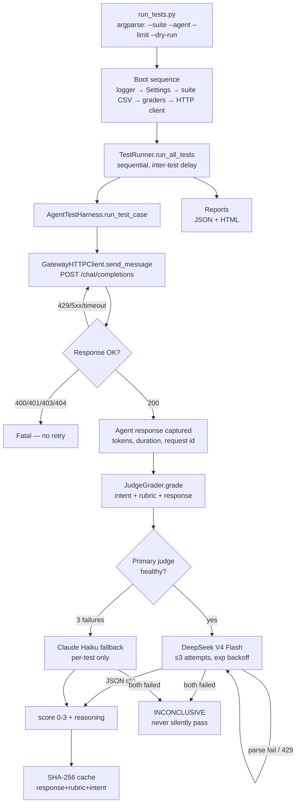

# Architecture

## End-to-end flow

## Components

### `config/settings.py` — configuration with validation
Loads env vars and **fails fast** on missing/invalid config: required vars present, base URL is valid HTTP(S), timeout > 0, numeric fields parse. Secrets are never written to logs (truncated preview only). `${VAR}` placeholders in `agents.yaml` are expanded from the environment at load time.

### `config/agents.yaml` — agent registry
The framework is agent-agnostic: each agent entry carries `name`, `endpoint`, and `model`. `--agent <key>` selects which one to test. Adding a new agent = adding a YAML entry + its test CSV.

### `utils/http_client.py` — `GatewayHTTPClient`
- OpenAI-compatible `POST /v1/chat/completions` caller
- Distinguishes **transient** errors (429, 500, 502, 503, 504, timeout, connection) → retried with exponential backoff — from **fatal** errors (400, 401, 403, 404) → fail immediately
- `CircuitBreaker` stops cascading 429s: when the agent is rate-limiting, consecutive failures trip the breaker instead of hammering the endpoint
- Returns normalized dict: `status_code, agent_response, tokens_used, duration_ms, session_key, request_id`

### `harness/agent_test_harness.py` — test execution
- `run_test_case()` sends the prompt, times it, and routes the response to the grader
- `_grade_response()` sends **every** test to the judge (the `assertion_method` column is accepted but ignored — judge-only was a deliberate migration decision)
- `generate_report()` aggregates by dimension and priority, computes pass rates, extracts failure details, and builds the report dict consumed by both output formats

### `harness/graders/judge_grader.py` — the judge (core)
| Concern | Implementation |
|---|---|
| Prompt | `intent` + `judge_rubric` + `agent response` → strict JSON `{score, reasoning, passed}` |
| Primary | DeepSeek V4 Flash (OpenAI-compatible endpoint) |
| Fallback | Claude Haiku 4.5 via Anthropic API — activates after 3 primary failures, **resets per test** |
| Retry | 3 attempts, exponential backoff 250 ms base / 8 s cap, honors `Retry-After` on 429/503 |
| Parsing | strips markdown fences, validates JSON, clamps score to 0–3, `passed = score >= 2` |
| Cache | SHA-256 of `(response + rubric + intent)` persisted to disk — identical content is free |
| Observability | routing decisions logged to a dedicated file-only log (`judge_routing.log`), never mixed into results |
| Stats | calls, fallbacks, errors, running average score (Welford's incremental formula) |

### `runners/test_runner.py` — orchestration & reporting
Sequential execution (the agent gateway allows concurrency 1) with configurable inter-test delay. Emits:
- **JSON** — machine-readable: full results incl. agent responses, tokens, failure reasons (usable by downstream automation)
- **HTML** — human dashboard from `report_template_v2.html`: KPI cards, pass-rate bar, dimension/priority breakdowns, expandable failure cards with full prompt/response/rubric context

### `runners/rerun_failed_tests.py` — failure recovery
Loads the latest report, keeps passing tests, re-runs failures with per-test escalating backoff (30/60/90/120 s on 429), merges results, and regenerates consolidated reports. Rate-limit noise never erases real results.

### Failure-handling philosophy
1. **Transient** → retry harder, with increasing patience
2. **Fatal** → fail fast, don't waste quota
3. **Judge unavailable** → mark `INCONCLUSIVE` explicitly — a missing grade must never look like a pass
4. **Everything** → logged with test IDs for post-hoc analysis
